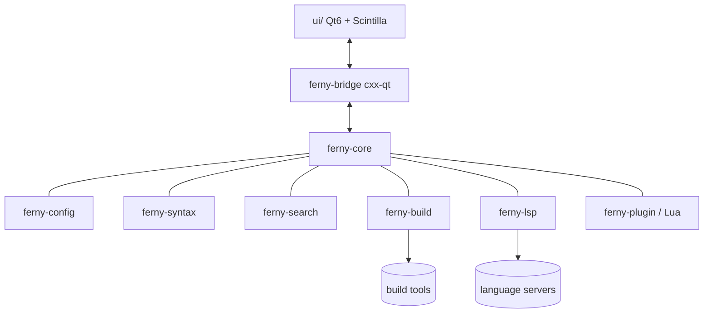

# Ferny — Technical documentation (AI-parseable)

Stable headings so agents can parse and extend it.
Unknown values are marked `[TO COMPLETE]` or `not verified`.

- Project: Ferny · Version: 0.6.17 (phase 4 feature) · Doc date: 2026-10-22
- Review owner: maintainer (ferny@ferarg.com)

## 1. Executive summary

- **Purpose**: lightweight, native programmer's editor with Geany's feature
  set and simplicity, on macOS, Linux and Windows.
- **Key technologies**: Rust (core), C++17 + Qt6 Widgets (UI), Scintilla +
  Lexilla, tree-sitter, LSP, Lua 5.4 (`mlua`), TOML, CMake + Corrosion +
  cxx-qt.
- **Target users**: programmers who want a fast editor with IDE basics
  (symbols, build, LSP) without a heavy IDE.

## 2. System architecture

See [ARCHITECTURE.md](../ARCHITECTURE.md), [DESIGN.md](DESIGN.md) §2–3 and
the trust-boundary diagram in [THREAT-MODEL.md](THREAT-MODEL.md) §4.



## 3. Features (phase 1 MVP)

### 3.1 Open file

- **Inputs**: path from dialog, drag & drop, CLI (`path[:line[:col]]`) or IPC.
- **Outputs**: new tab with detected encoding, EOL and filetype.
- **Security controls**: path canonicalised; size thresholds; bounded
  encoding detection; no code execution; bidi/invisible characters visible.

```gherkin
Scenario: Opening a file never executes project content
  Given a folder that contains ".ferny/project.toml" with a build command
  And the folder is not trusted
  When the user opens "main.c" from that folder
  Then the file is shown with syntax highlighting
  And no process is spawned
  And a restricted-mode banner offers to trust the folder
```

```gherkin
Scenario: Huge file degrades gracefully
  Given a synthetic 200 MB text file
  When the user opens it
  Then the UI stays responsive
  And tree-sitter highlighting is disabled for that document
```

### 3.2 Save file

Implemented in H1.1 (`ferny_core::fsio::write_atomic`,
`ferny_core::document::Documents::save`).

- **Inputs**: buffer text, target path, encoding, EOL, BOM.
- **Outputs**: file on disk, unchanged permissions.
- **Security controls**: atomic write; symlink handling; external change
  check; 0600 for backups.

```gherkin
Scenario: Save is atomic
  Given an open file with unsaved changes
  When writing the file fails half-way (disk full)
  Then the original file on disk is unchanged
  And the user sees a generic error and keeps the unsaved buffer
```

### 3.3 Single instance (IPC)

- The v1 wire format accepts decimal line/column fields with leading zeros;
  decoding parses their numeric value and encoding emits canonical decimal
  spelling. The fuzz property checks semantic round-trip, not byte identity.

```gherkin
Scenario: Another OS user cannot talk to my Ferny
  Given Ferny is running for user "alice"
  When user "bob" connects to alice's socket
  Then the connection is refused by filesystem permissions
```

### 3.4 Find / replace, find in files

- **Security controls**: linear-time regex engine; result count and file
  size limits; search confined to the chosen directory; binary files skipped.

### 3.5 Geany importer

```gherkin
Scenario: Importer confines template paths
  Given a Geany templates directory with a file named "../../evil.sh"
  When the user imports the Geany configuration
  Then no file is written outside the Ferny config directory
  And the import report lists the rejected entry
```

[TO COMPLETE: phases 2–4 features as they are designed.]

## 4. Data and formats

There are no AI models. Persistent data:

| File | Format | Location | Classification | Permissions |
|---|---|---|---|---|
| `settings.toml`, `keybindings.toml`, `filetypes/`, `colorschemes/`, `snippets.toml` | TOML | user config dir | internal | user default |
| `session.toml` (open files, recent files, geometry, dock layout, Scribble notes) | TOML | user data dir | personal (paths, notes) | 0600 |
| `trust.toml` (trusted folders, H2.1; ≤ 64 KiB, ≤ 256 folders) | TOML | user config dir | security-relevant | 0600 |
| `build.toml` (user build commands, H2.4; ≤ 64 KiB, validated) | TOML | user config dir | security-relevant | 0600 |
| `projects/<id>.toml` (open files of a project, H2.5a) | TOML | user config dir | personal (paths) | 0600 |
| `lsp.toml` (language servers, H3.1a; ≤ 64 KiB, validated) | TOML | user config dir | security-relevant | user default |
| `plugins/<id>/plugin.toml`, `main.lua` (H3.2; 16 KiB / 1 MiB, validated) | TOML, Lua | user config dir | untrusted code | user default |
| `plugin-grants.toml` (plugin decisions, H3.2; first-use answers, H3.3b) | TOML | user config dir | security-relevant | 0600 |
| `dictionaries/<lang>.aff`, `.dic` (user, H4.2c; ≤ 32 MiB) and `dictionaries/personal.txt` (user words) | Hunspell, text | user config dir | user data | user default / 0600 |
| `ferny.log`, `ferny.log.1` (events, never contents; 1 MiB each, H3.2) | text | user config dir | internal | 0600 |
| `.ferny/project.toml` (H2.5a; ≤ 64 KiB) | TOML | project folder | untrusted input | as created |
| Backups (`backups/<key>/<time>-<name>`, H4.2a, off by default) / unsaved buffers | text | user data dir | confidential | 0600 (folders 0700) |
| `.ferny/project.toml` | TOML | project dir | untrusted input | — |

Synthetic example:

```toml
# trust.toml
[[workspace]]
path = "/home/example/src/demo"
trusted_at = 2026-10-15T12:00:00Z
```

## 5. Configuration and deployment

- System requirements: [TO COMPLETE: minimum macOS/Windows versions, glibc].
  Reference build machines: macOS 27 arm64 (development Mac), Debian 13 (trixie)
  amd64, Windows 11 x64.
- Setup: [SETUP.md](SETUP.md). Build: CMake (≥ 3.28) + Ninja; the
  top-level `CMakeLists.txt` builds Scintilla, Lexilla, the Rust bridge
  (Corrosion) and the Qt app `ferny`. Configuring is offline (vendored
  CMake modules, `FETCHCONTENT_FULLY_DISCONNECTED`); Cargo fetches the
  crates pinned in `Cargo.lock`. Cargo commands on the workspace need Qt
  installed (the bridge's build script runs `qmake`).
- No secrets are needed to build; signing credentials stay on the
  maintainer's machines ([RELEASE-GATE.md](RELEASE-GATE.md)).
- macOS package (H1.6c): `scripts/package-macos.sh` →
  `bin/ferny-v<VERSION>-macos-arm64.dmg` + `.sha256`; ad-hoc signature,
  not notarised; built against Homebrew Qt 6.12, so it runs on the macOS
  version of the build machine or later (minimum not verified;
  [TO COMPLETE] with a universal build before 1.0). See
  `packaging/README.md`.

## 6. Testing and validation

- Unit tests per crate (`cargo test`), UI smoke tests (CTest), security
  regressions in `test/security/`, fuzz targets (`cargo fuzz`).
- Validation gate: `scripts/check.sh` / `scripts/check.ps1`, tested by
  `test/scripts/` (11 tests passing on macOS, 2026-10-15; Windows test
  not run yet).
- Cargo validation uses `--locked`; regenerate and review the workspace lockfile
  whenever any workspace package version changes. CTest runs only after a
  successful CMake build; dependent checks are reported as skipped on failure.
- C++ gate treats Ferny source warnings as errors; generated CXX-Qt bridge
  include paths are marked as system includes, subject to cross-platform build
  verification.
- The IPC UI smoke test detects BSD/macOS versus GNU `stat` before querying
  endpoint-directory permissions; this keeps the same 0700 assertion portable.
- Secret scanning: gitleaks via `.githooks/pre-commit` (staged changes)
  and `.githooks/pre-push` (full history).
- H4.3 on macOS: SBOM test; packaging script tests 10 (signing checked
  before building, SBOM never overwritten); an ad-hoc package of a
  committed ref built outside `bin/` to check the SBOM in the bundle.
- H4.2d on macOS: 4 git tests; CTest builds a repository and checks the
  status marks, blame and nothing in an untrusted folder (164).
- H4.2c on macOS: 4 spell tests with a synthetic dictionary; CTest adds
  plain text, code, off by default and the View toggle (159). The
  context menu is not tested automatically.
- H4.2b on macOS: 5 Markdown tests; CTest adds the preview of a hostile
  fixture and of a non-Markdown file (155).
- H4.2a on macOS: 2 backup tests, 1 symbol parser test; CTest adds
  autosave with a backup copy, autosave off by default, mark
  occurrences, enclose, and LSP symbols (sidebar and workspace) with
  clangd (153).
- H4.1b on macOS: CTest adds the split view sharing the document, top
  and bottom, unsplit, and closing the tab it shows (143).
- H4.1a on macOS: 4 export tests (runs and colours, HTML and LaTeX
  escaping, visible controls); CTest adds HTML, LaTeX and PDF export of a
  fixture with their contents checked (139). The print dialog is not
  tested automatically.
- Phase 3 audit on macOS: 2 pattern tests (57 cases compared with C
  Lua, the time limit), 1 process-group test; fuzz target
  `lua_patterns`; every fuzz target ran 10 minutes.
- H3.4 on macOS: 4 more plugin tests (bundled plugins load and work,
  Class Builder writes only new files in the project, reserved ids,
  first-use answers kept and reset); CTest adds both bundled plugins and
  safe mode listing plugins (133).
- H3.3c on macOS: 4 more plugin tests (providers per filetype, bounded
  answers, chained `before_save` and its time limit, stubs matching the
  API) and 1 keybinding test; CTest adds plugin completion, hover,
  formatting and `before_save` (130).
- H3.3b on macOS: 7 more plugin tests (project-only reads, `fs.read.any`
  confirmation, confined writes, process requests and argument vectors,
  timeouts and output bounds, clipboard, remembered confirmations);
  CTest adds a plugin that lists, writes and runs a program in a trusted
  project (124).
- H3.3a on macOS: 6 more plugin tests (events, edits only in commands,
  command validation, bounds and neutralised texts, time limit in events,
  locale); CTest adds an event handler, a disabled slow handler and a
  translated command that edits the document (120).
- H3.2 on macOS: 6 plugin tests (sandbox escapes, limits through
  `pcall`, manifests, discovery, grants) and 2 log tests; fuzz target
  `plugin_manifest`; CTest adds a plugin that runs and logs, a hostile
  one stopped, and safe mode (118).
- H3.1c on macOS: 1 more LSP test (edits parsed, bounded, applied,
  overlaps refused); CTest adds rename and formatting with clangd (113).
- H3.1b on macOS: 2 more LSP tests (positions round trip, answers
  parsed and bounded); CTest adds, with clangd, definition into an
  unopened header, usages, hover, signature help and completion (111).
- H3.1a on macOS: 10 LSP tests (framing and bounds, secret files,
  reduced environment, URIs, diagnostics, positions, configuration, a
  scripted server's lifecycle and crash); fuzz target `lsp`; CTest adds
  no server in an untrusted folder and, with clangd, real diagnostics and
  a secret file not sent (106 tests).
- H2.5c on macOS: phase-2 audit; CTest adds a planted program that must
  not run, Execute blocked in an untrusted folder and allowed when
  trusted (101 tests).
- H2.5b on macOS: 5 template/snippet tests and 1 importer test; CTest
  adds New from Template (main.c), a snippet with Tab and Tab without a
  snippet (99 tests).
- H2.5a on macOS: 7 project tests (valid project, base folder confined,
  invalid entries dropped, invalid files refused, create never
  overwrites, `.geany` import maps and lists, session id); fuzz target
  `project`; CTest adds open through the menu, reopen at start with the
  project indentation, commands blocked until trusted, a trusted project
  command, a `.geany` import (96 tests).
- H2.4 on macOS: 7 build tests (Geany templates, shell syntax refused,
  placeholders never split, PATH resolution skipping project and
  relative entries, output neutralisation, error locations, `build.toml`
  validation); fuzz target `build_commands`; CTest adds build and execute
  of a file named `a b $(echo pwned) 'q'.c`, a clickable compile error,
  bounded output, Make blocked when untrusted and run when trusted (87).
- H2.3 on macOS: 2 completion tests; CTest adds go to definition,
  back, forward, go to symbol, complete word and the palette, each
  through its command (79 tests).
- H2.2 on macOS: 3 symbol tests (five languages, hostile and huge
  input within the time budget, symbol cap); fuzz target `symbols`;
  CTest adds C++, Rust and plain-text Symbols tabs (73 tests).
- H2.1 on macOS: 7 trust tests (folder and below, component-wise
  prefix, links, root refused, missing folders, save/load/revoke with
  0600, invalid stores trust nothing); CTest adds Restricted by default,
  trusting through the command, trust applied on the next start, root
  refused (70 tests).
- H1.6c on macOS: 7 packaging-script tests; a DMG built from the
  milestone commit passed every verification step; every fuzz target run
  10 minutes in the phase audit (no failures).
- H1.6b on macOS: 4 translation tests (core strings current, catalogue
  complete, placeholders kept, placeholder scanner); CTest adds Spanish by
  option and by setting, English by default and for unknown values (65
  tests).
- H1.6a on macOS: 6 directory-listing tests (hidden files and order,
  escaped names, real path kept, 5,000-entry bound, errors without paths,
  links not followed; non-UTF-8 names on Linux only, not verified) and a
  Scribble bound test; CTest adds the status bar fields, read-only state,
  Documents and Files sidebars, an unlistable folder, the Scribble round
  trip and the Geany import through the menu (61 tests).
- H1.5b on macOS: 8 importer tests (settings mapped, unmapped listed,
  no commands imported, GTK accelerators, files written only inside the
  config dir and used by the catalog, escaping paths refused, symlinked
  and oversized files skipped, missing directory) and 2 user-catalog
  tests; CTest adds import into a fresh directory, then the imported
  filetype, scheme and shortcut in use (56 tests); fuzz target
  `geany_import`.
- H1.5a on macOS: 8 configuration tests (defaults valid, layer order,
  invalid values ignored per key, broken and oversized files, validated
  `set`, save keeps unknown keys and writes only changes, keybindings
  overrides/validation/conflicts, macOS reserved shortcuts) and a new
  document test; CTest adds settings applied, a broken settings file,
  keybinding override and default (52 tests); fuzz target `settings`.
- H1.4 on macOS: 12 search tests (forward/backward with wrap, case,
  whole word, literal vs regex, UTF-8 offsets, captures, replace all,
  invalid and oversized patterns, a catastrophic pattern in linear time,
  find in files with patterns, VCS dirs, large/binary skipped, result
  limit, cancellation, symlinks and FIFOs not followed); CTest adds
  find next/previous, invalid regex, replace all compared byte for byte,
  find in files (48 tests); fuzz target `search`.
- H1.3c on macOS: 9 `.editorconfig` tests (spec globs, precedence,
  `root`, `unset`, unknown keys and bad values ignored, oversized file,
  pathological glob), 2 document tests (charset decoding, BOM and EOL for
  new content) and modeline detection; CTest adds editorconfig
  indentation, save transforms on a copy compared byte for byte, and the
  modeline (42 tests).
- H1.3b on macOS: 9 editing tests (comment toggling round trips with
  line and block tokens, CRLF, Unicode whitespace; every bidi and
  invisible character detected); CTest adds the Trojan Source warning,
  comment/uncomment round trips, real key presses for auto-close and
  auto-indent, and an unknown command (37 tests).
- H1.3a on macOS: 10 catalog tests (all embedded files parse, scheme
  licences known, every scheme × filetype resolves, detection by name and
  shebang, Geany style and colour semantics, linear globs) and the
  generated-data check; CTest adds shebang, Makefile, custom filetype and
  scheme tests (29 tests).
- H1.2 on macOS: 21 tests for command-line locations, IPC requests
  (round trip, size, count, kinds, relative paths, control characters),
  endpoint directory and socket checks, session round trip, owner-only
  mode, invalid and oversized sessions, sanitising, recent list and
  canonical duplicate detection; IPC accepts leading-zero decimal positions
  and normalizes them on encoding; CTest adds tabs/positions, session save
  and restore, and a two-process single-instance test (23 tests); fuzz
  targets `ipc_request` (semantic round trip) and `session`.
- H1.1 on macOS: 17 document tests (limits, file types, encoding
  detection, BOM, UTF-16, binary refusal, malformed input read-only, EOL)
  and 15 save tests (encoding round trips, atomic rename without leftovers,
  unencodable text refused, external modification and deletion, failure
  keeps the original, mode preserved, read-only files, symlink
  write-through, dangling links, hard links, planted symlinks); 17 CTest
  tests including 4 open → save as → byte-compare round trips; fuzz target
  `decode` (60 s per gate run).
- H5.2 on Debian (branch `h5.2-preferences-redesign`): Preferences
  reorganized into the categories General, Editor, Files, Templates and
  Security over the26 typed descriptors, every descriptor with exactly one
  editor; help notes only where behavior is confirmed (language restart,
  `.editorconfig`/filetype precedence, immediate revocation) and a General
  link to the shortcuts editor. Values still apply only on OK. CTest
  `ui_prefs_categories` verifies coverage, the approved category layout and
  the apply round trip (`--language en`). macOS/Windows: not verified.
- H5.1 on Linux: fixed icon-based main toolbar from nine built-in command
  IDs (Lucide icons with accessible names), dispatches through the core
  registry, and keeps Undo/Redo enabled state synchronized to the active
  editor. Toolbar presence and command IDs checked by CTest smoke coverage.
  Drag-and-drop flow unchanged; dedicated UI drop automation remains not
  verified.
- H0.5 on macOS: 9 command-registry tests (id, title and key validation,
  duplicates, menus referencing unknown commands, core vs UI dispatch,
  unknown ids fail closed); the start smoke test checks the menu commands.
- H0.3 on macOS: 10 tests in `ferny-core` (limits, encoding, non-regular
  files, symlinks, no path in errors) and 6 CTest smoke tests (start, open
  C++ and Rust with highlighting, reject non-UTF-8, missing file and
  directory) running headless (`QT_QPA_PLATFORM=offscreen`). Coverage:
  not measured. Targets, not
  measurements: cold start < 200 ms, typing latency < 5 ms.

## 7. Security and errors

See [THREAT-MODEL.md](THREAT-MODEL.md) (assets, threats T1–T17, controls,
residual risk) and [SECURITY.md](../SECURITY.md). Errors shown to the user
are generic; details go to a local log without file contents.

## 8. Roadmap

See [ROADMAP.md](ROADMAP.md). Known security challenges: workspace trust
UX, Lua sandbox strength, C/C++ components outside Rust's guarantees,
cross-platform signing.

## 9. Technical metadata

- Main languages: Rust 1.99 (pinned, edition 2024), C++17. Qt API
  floor 6.8.
- Critical dependencies: see [DEPENDENCIES.md](DEPENDENCIES.md) (versions,
  licences, origins and advisory checks).

- Licence: GPL-2.0-or-later. Authors: [TO COMPLETE].
