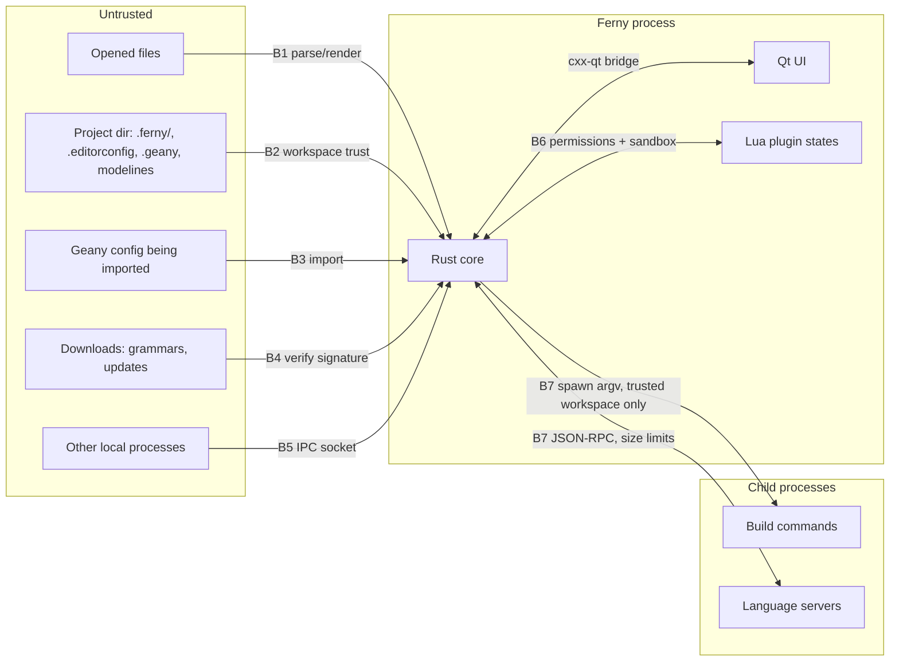

# Ferny — Threat model

Status: v0.2 · 2026-10-15 · approved by the maintainer (R1–R5) · method:
STRIDE, per trust boundary.
Living document: review with every change to architecture, data flows,
features, dependencies or packaging.

## 1. Context

- **Scope**: the Ferny desktop application (core, UI, plugin host, LSP
  client, build runner, IPC, importer), its build pipeline and its release
  artefacts.
- **Environment**: single-user desktop on macOS, Linux and Windows. No
  server component, no accounts, no telemetry.
- **Data classification**:
  - User files and projects: *confidential* (may contain source code,
    credentials in `.env`, personal data). Ferny must not leak them.
  - Settings, sessions, recent files: *internal/personal* (paths reveal
    project names and usernames).
  - Plugins, grammars, language servers: *untrusted code*.
  - Signing keys and notarisation credentials: *secret* (maintainer's
    machines or hardware tokens only, never in the repo).
- **Assumptions**: the OS account is not compromised; the user decides
  which folders to trust; Ferny runs with the user's privileges and never
  requests elevation.

## 2. Assets

| Asset | Property |
|---|---|
| Content of opened files | Confidentiality, integrity (no data loss on save) |
| User's machine/account | Integrity: no code execution the user did not intend |
| Settings, sessions, keybindings | Integrity, availability |
| Plugin and grammar ecosystem | Authenticity |
| Release artefacts and updates | Authenticity, integrity |
| Editor responsiveness | Availability |

## 3. Actors

- **User** (legitimate, owner of the machine).
- **Author of an opened file or cloned repository** — untrusted; the most
  important attacker. A malicious repo is a realistic threat (the same class
  that led VS Code to add Workspace Trust).
- **Plugin author** — semi-trusted after the user installs a plugin, within
  the declared permissions only.
- **Language server / build tool** — trusted only if the user trusts the
  workspace and the executable comes from a trusted location.
- **Other local OS users / processes** — untrusted (IPC, temp files).
- **Network attacker** — relevant only for downloads (grammars, updates).
- **Supply-chain attacker** — compromised crate, C/C++ library, grammar,
  build tool or build machine.

## 4. Entry points and trust boundaries

| Id | Boundary | What crosses it |
|---|---|---|
| B1 | File content → core/UI | Bytes in any encoding, any size, any characters |
| B2 | Project directory → core | Build commands, LSP config, project settings, `.editorconfig`, modelines |
| B3 | Geany config → importer | Keyfiles, filetype definitions, templates |
| B4 | Network → core | tree-sitter grammars (native code), application updates |
| B5 | Other local processes → core | Single-instance "open file" requests |
| B6 | Plugins ↔ core | Lua code, API calls, events |
| B7 | Core → child processes | Commands, environment, documents sent to LSP |
| B8 | Source → release artefact | Build machines, dependencies, signing |

## 5. Threats and controls

Priority: **H** high, **M** medium, **L** low (impact × likelihood).

### H5.1 toolbar scope

The fixed main toolbar adds no settings or trust boundary: its nine action IDs
are compiled into the UI, titles come from the built-in command registry, and
activation follows the same `invokeCommand` path as menu actions. Build and
Execute remain guarded by the core's existing workspace-trust checks. No
project-supplied toolbar entries or command strings are read. File drag-and-drop
is unchanged; its local-file open behavior was fixed in v0.5.2.

The v0.5.3 icon update vendors a bounded set of static Lucide SVG resources;
they are embedded at build time and introduce no runtime network or file reads.
The About dialog presents fixed links; the click handler allows only the
known Geany, FErArg and Lucide hosts with the HTTPS scheme, and the single
`mailto:` address `Info@FErArg.com` (v0.6.13). No URL can be supplied from
project content or configuration.

| # | STRIDE | Threat / abuse | P | Control (preventive / detective) | Test or evidence |
|---|---|---|---|---|---|
| T1 | E | Opening a malicious project runs code: build commands, LSP server path, project-local plugins or Lua config execute on open | H | **Workspace trust** (R1): untrusted folders open in restricted mode; no project build commands, LSP spawn, project plugins or project-supplied executables until the user trusts the folder or a parent folder; trust stored per canonical path, revocable in Preferences → Security; non-blocking banner plus a prompt on blocked actions; never auto-run anything on open | `test/security/workspace_trust_*` |
| T2 | E | LSP / tool binary resolved from project directory (`./node_modules/.bin`, `PATH` containing `.`) | H | Resolve executables from user-configured paths or system `PATH` with project dirs removed; show resolved path before first run | Unit tests on resolver |
| T3 | E/T | Shell injection via file names or settings in build commands (`%f`, `%e` placeholders) | H | No shell: program + argv vector; placeholders substituted per argument; shell use only if the user writes an explicit `sh -c` command | Tests with names containing `;`, `$()`, quotes, newlines |
| T4 | E | Malicious or compromised plugin escapes the Lua sandbox | H | One state per plugin, no `io`/`os.execute`/`loadlib`/`debug`/`load` of bytecode; capabilities only via `ferny.*` gated by manifest permissions; instruction and memory limits; `--safe-mode` | Sandbox escape test suite |
| T5 | T/I | Plugin abuses granted permissions (reads `~/.ssh`, exfiltrates) | M | Fine-grained permissions (`fs.read.project`, `fs.read.any`, `fs.write.project`, `process.spawn`, `net`, `clipboard`) granted at install, with first-use confirmation for `process.spawn`, `net`, `fs.read.any`; bundled plugins in the same sandbox; no network by default; per-plugin audit log (R2) | Permission denial tests |
| T6 | D | Crafted file freezes or crashes the editor (huge file, giant lines, pathological regex, deep nesting for tree-sitter, invalid encoding) | M | Size thresholds that disable heavy features; parse/highlight time budgets; `regex` crate (linear time) only; encoding detection bounded; background threads with cancellation | Fuzzing (`cargo-fuzz`) of encoding, importer, filetype detection; large-file tests |
| T7 | S/T | Deceptive content: bidi controls ("Trojan Source"), homoglyphs, invisible characters, terminal escape sequences in build output | M | Render bidi/invisible control characters visibly (option on by default); strip/neutralise ANSI escapes in message panel except a safe colour subset | Fixture files with bidi and escape sequences |
| T8 | I/T | Other local user sends "open" requests or reads info via the single-instance socket | M | Socket in per-user runtime dir with 0700 dir / 0600 socket (Unix), per-user named pipe with restrictive DACL (Windows); request size limit; only open-file requests with validated paths; decimal line/column fields are bounded and parsed as numbers (leading zeros accepted, normalized on encoding); another user's socket → separate instance, stale socket → recreate (R3) | IPC permission tests, unit regression for leading-zero normalization, `ipc_request` semantic round-trip fuzz target |
| T9 | T | Save loses data or follows a planted symlink / races (TOCTOU) | M | Atomic save (temp in same dir, fsync, rename); preserve mode/ownership; explicit handling of symlinks and hard links; detect external modification before overwrite | Save tests incl. symlink, read-only, full disk |
| T10 | I | Sensitive content leaks via logs, crash reports, session files or temp/backup files | M | No file content in logs; no crash upload; session/backup files with 0600; backups in user data dir, not next to the file; documented locations | Log review test, permission tests |
| T11 | T/E | Malicious Geany config during import (path traversal in templates, oversized values, command strings) | M | Importer is a pure parser: no execution, paths confined to Ferny config dir, size limits, imported build commands marked untrusted until reviewed | Importer fuzzing + traversal tests |
| T12 | T/E | Tampered grammar download (native code) or update | H | Grammars compiled in; no automatic updates (R4). Any future download: HTTPS + pinned minisign key + checksum, fail closed | Signature verification tests |
| T13 | T | Modelines / `.editorconfig` change behaviour unexpectedly | L | Only a documented allowlist of keys (indent, EOL, charset, filetype); never commands | Unit tests |
| T14 | E/T | Supply-chain compromise (crate, Qt, Scintilla, grammar, build tool) | H | `Cargo.lock` committed; `cargo deny` (licences, advisories, sources = crates.io only, bans); `cargo audit`; vendored C/C++ pinned, cross-checked against a second official source and verified file by file against SHA-256 manifests; pinned Rust toolchain; SBOM per release (`tools/ferny-sbom`, CycloneDX, H4.3) | Validation script (see `docs/RELEASE-GATE.md`); SBOM since H4.3 (`sbom_lists_crates_vendored_code_and_qt`) |
| T15 | S/T | Fake or tampered Ferny binaries | H | minisign-signed checksums + SBOM for every artefact, published with the public key on the maintainer's Git server (R4); builds only from clean checkouts of signed tags on the maintainer's machines; Developer ID signing and notarisation supported by the packaging script (H4.3) once the maintainer has the certificate; Authenticode later | Release gate checklist |
| T16 | I | LSP server receives files outside the workspace or secrets files | L | Only documents of the trusted workspace are sent; `.env`-like files excluded by default from LSP sync | Unit tests |
| T17 | R | Unclear which plugin or command did something | L | Local, non-sensitive activity log: plugin id, permission used, spawned program (no arguments with content) | Review |

## 6. Security acceptance criteria (per phase)

- **Phase 0**: local security gate running on the three OS (fmt, clippy,
  tests, `cargo deny`, `cargo audit`, gitleaks, Semgrep). `unsafe` confined to the bridge.
- **Phase 1**: T6, T7, T8, T9, T10, T11, T13 controls with tests; fuzz
  targets for encoding detection and the Geany importer.
- **Phase 2**: T1, T2, T3 (workspace trust ships together with build
  commands, not later).
- **Phase 3**: T4, T5, T16, T17 (plugin sandbox and permissions ship
  together with the plugin host).
- **Phase 4 / first public release**: T12, T14, T15 complete; full
  `security-audit` of the release candidate.

## 7. Residual risk and unverified controls

- T6, T13 (H4.2f, editing preferences): indentation detection reads at most
  500 lines, never executes or follows anything, and changes only the width and
  style of the document being opened. It runs after `.editorconfig` and project
  settings and before the user's defaults. Quote auto-close is off by default.
  Not verified: manual use of the editor; fuzzing runs in the gate only.
- T1–T3, T6, T7, T16 (H4.2d): git runs only in trusted folders, resolved
  outside the project, with an argument vector, a reduced environment,
  no prompts, 10 s and bounded output, and with fsmonitor, hooks,
  external diff and textconv switched off. Residual risk: a trusted
  repository's clean/smudge filters run when git reads the working tree.
- T6, T7, T9 (H4.2c): spelling dictionaries are read only from the
  user's dictionaries folder and the system's read-only ones, with a
  validated language name, 32 MiB and UTF-8 limits; checks are bounded
  and debounced; the personal word list is written atomically and
  owner-only.
- T5, T6, T7 (H4.2b): the Markdown preview has no script engine, shows
  raw HTML as text, never loads images or other resources, keeps links
  only for http, https, mailto and anchors (opened only when clicked) and
  skips documents over 2 MiB.
- T6, T7, T9, T10 (H4.2a): backup copies (off by default) go to the
  user's data folder, owner-only, never next to the file, at most 5 per
  file and 64 MiB each, refused through a linked folder; autosave (off
  by default) never forces over a file changed on disk; server symbol
  names are bounded and neutralised. Residual risk: enabled backups keep
  old versions of confidential files in the data folder.
- T6, T7, T9 (H4.1a): HTML and LaTeX exports escape every special
  character of the untrusted text (no markup, no `\input`/`\write18`),
  write controls and deceptive characters as visible escapes, and are
  written atomically after the save dialog; printing runs on the UI
  thread page by page (a very large document blocks while it prints).
- T4, T6 (phase 3 audit): Lua's C pattern functions are replaced by a
  budgeted Rust port (the hook cannot stop C code); other C library
  functions stay bounded by size and memory (`table.sort` of a large
  table can exceed 50 ms by a bounded amount). Plugin processes run in
  their own process group, killed on time-out and when Ferny quits.
- T14, T15 (H4.3): the macOS packaging script writes a CycloneDX SBOM
  next to the DMG and inside the bundle, signs with a Developer ID and
  notarises when the maintainer's environment provides an identity and a
  notarytool profile, and signs the checksum with the maintainer's
  minisign key; half-configured signing stops it before building. Not
  verified by the agent: real Developer ID signing, notarisation and
  minisign signatures.
- T4, T5, T7, T15 (H3.4): bundled plugins are compiled into the binary
  (no run-time files to tamper with), start disabled and get the same
  sandbox and grants as user plugins; user plugins cannot take the
  reserved `ferny-` ids; the manager changes only what the user ticks
  and safe mode can still disable a broken plugin. Phase 3 controls (T4,
  T5, T16, T17) are reviewed in the phase 3 security audit.
- T4–T7, T9, T10 (H3.3c): plugin providers run within 50 ms for their
  filetypes only; completion items (500 × 256 bytes, no controls) and
  hovers (4 KiB, escaped) are bounded; formatted and `before_save` text
  (16 MiB) replaces the buffer as one undo action, and only the user's
  Save writes it; plugins cannot declare shortcuts and user keys that
  collide with built-in commands are ignored. Residual risk: providers
  and `before_save` handlers read the text of the documents they serve.
- T1–T3, T5, T6, T9, T10, T17 (H3.3b): plugin file access is limited to
  the open project while it is trusted (`fs.read.any` for anything else,
  confirmed at first use); links are not followed; writes are atomic,
  inside the project, never through a link; processes are resolved on
  `PATH` without project folders, get an argument vector, a reduced
  environment and closed stdin, are killed after 30 s, keep 512 KiB per
  stream, at most 4 per plugin, and `process.spawn` is confirmed at first
  use; the clipboard is read only in commands. Residual risk: a
  confirmed `process.spawn` runs any program with the user's rights; a
  check-then-open race between the link check and the read remains.
- T4–T7, T9, T10 (H3.3a): plugin events and commands run within 50 ms;
  a plugin out of time is disabled for the session; documents' text
  reaches plugins only in commands the user runs, and edits land on that
  document as one undo action, unsaved; actions are bounded (64 per call,
  1 MiB of edits, 4 KiB messages) and shown texts escaped; command titles
  validated. Residual risk: an enabled plugin can copy the text of a
  document on which the user runs its command into `ferny.log`.
- T4, T5, T10, T17 (H3.2): plugins load only from the user's folder,
  each in its own Lua 5.4 state with `table`, `string`, `math` and `utf8`
  (no `io`, `os`, `debug`, `coroutine`, `load`, `require`,
  `string.dump`; text chunks only), 50 ms per call checked every 1,000
  instructions and re-raised through `pcall`, 64 MB; a new or changed
  manifest asks the user, grants are stored owner-only; `--safe-mode`
  loads none. The local log (`ferny.log`, 0600, 1 MiB × 2) records
  events only, escaped and cut at 512 bytes. Residual risk: Lua's C
  implementation (fuzzed upstream, not by Ferny); a plugin can burn
  50 ms per call; permissions are recorded but their APIs and
  first-use confirmation arrive in H3.3.
- T14, T15 (H1.6c, first artefact): the DMG is built offline from
  `git archive` of a named ref; every Mach-O is arm64 and loads only from
  the bundle or the system (absolute rpaths removed); `qt.conf` keeps Qt
  plugins and translations inside the bundle (verified with
  `QT_DEBUG_PLUGINS`); ad-hoc signature only; SHA-256 next to the DMG;
  component list instead of a full SBOM (H4.3). Residual risk: no
  Developer ID or notarisation, no minisign signature yet, bundled
  Homebrew libraries as current as the build machine.
- T1, T6, T9 (H3.1c): rename and formatting never write files: changes
  land in the editor, unsaved, one undo action per file, after a preview
  for renames; a file outside the workspace or a file operation refuses
  the whole answer; overlapping edits refuse that file; answers bounded
  (200 files, 10,000 edits, 16 MiB).
- T6, T7, T10 (H3.1b): server answers are bounded (500 items, 4 KiB
  texts) and neutralised; tooltips show escaped plain text; the lines of
  reference locations are read only inside the server's workspace; no
  snippet support is announced.
- T1, T2, T6, T16 (H3.1a): language servers start only for trusted
  workspaces, are resolved on `PATH` without project folders, and get a
  reduced environment (`PATH`, `HOME`, `USER`, `LANG`, `LC_*`, `TMPDIR`
  plus names allowed in `lsp.toml`); secret-looking files are never sent;
  server messages are bounded (8 KiB headers, 16 MiB bodies), parsed with
  `serde_json`, only diagnostics are used (1,000 per document, 4 KiB,
  neutralised); stderr is discarded; initialize timeout 10 s, kill 2 s
  after shutdown, at most 3 restarts. Residual risk: the server binary is
  trusted once resolved and reads the workspace with the user's rights.
- T1, T2 (phase-2 audit, F1 fixed in v0.3.0): a program from the folder
  itself (`./%e`, Execute) runs only in trusted workspaces — an
  untrusted folder could hold a planted executable with the expected
  name. Interpreters from `PATH` (`python3 %f`) still run the file
  (R1), as Compile and Build do.
- T1, T3 (H2.5b): templates and snippets are text substitutions only;
  Geany's `{command:…}` is not supported and stays as written; user
  templates are bounded (64 KiB, 200 files, no links).
- T1, T3, T10, T11 (H2.5a): projects are opened only on request; their
  build commands (and Make) need the project root to be trusted; the
  base folder must stay inside the project (links resolved); every
  command is validated (no shell syntax); `.geany` import previews,
  lists what it leaves out and never overwrites; project sessions are
  kept in the user's configuration (0600), not in the shared folder.
- T1–T3, T7 (H2.4): no shell anywhere — templates are split once,
  placeholders are substituted inside arguments, unquoted shell syntax is
  refused; programs come from `PATH` without empty, relative or project
  entries (`./prog` only for Execute); Make requires a trusted folder
  (checked in the core) and otherwise shows the banner and the prompt;
  output has escape sequences removed and control/bidi characters
  escaped, 4 MiB / 10,000 lines kept; every run shows the exact program,
  arguments and folder. Residual risk: Execute runs the user's program
  with the user's rights and inherited environment; Compile/Build of a
  file from an untrusted folder runs the compiler on it (R1, as Geany).
- T6, T14 (H2.2): tree-sitter parses untrusted text in C: sources over
  8 MiB are skipped, parsing and querying stop after 1 s (progress
  callbacks), at most 10,000 symbols; fuzz target `symbols` for all five
  grammars; grammars pinned from the official organisation on crates.io.
  Residual risk: the generated C parsers are not reviewed line by line.
- T1–T3 gate (H2.1): workspace trust per folder or parent folder,
  canonical component-wise checks (links resolved first, `~/src2` is not
  in `~/src`), the root never trusted, the home folder only after a
  warning; `trust.toml` owner-only and read strictly (invalid → nothing
  trusted). Nothing executes yet; the banner and the prompt on blocked
  actions come with H2.4/H2.5.
- Implemented so far: T14 controls except SBOM (H0.2–H0.3); T6 for
  documents (regular files only, 256 MiB limit, bounded detection,
  highlighting off above 32 MiB, binary refusal, malformed input
  read-only, fuzz target `decode`) and T9 (atomic save, exclusive temp
  files, permissions kept, symlink write-through, hard-link and owner
  fallback, external-change detection) in H1.1; T10 for documents (no
  paths or contents in errors). H1.2: T8 (private 0700 endpoint
  directory, Qt `UserAccessOption`, foreign/symlinked sockets refused,
  stale sockets replaced, bounded validated requests, fuzz target
  `ipc_request`) and T10 for the session (0600 file, 0700 directory,
  1 MiB limit, sanitised entries, fuzz target `session`). Every other
  control is **not verified**.
- T11 (H1.5b): the Geany importer is a pure parser with a preview before
  writing; build commands, context actions and keys outside the
  allowlists are listed as not imported; outputs are validated ids inside
  Ferny's config directory; 1 MiB per file, 500 files, symlinks not
  followed; user filetypes can only extend built-in lexers; fuzz target
  `geany_import`.
- Settings and keybindings (H1.5a): 256 KiB per file, every known key
  validated on its own, unknown keys kept but never interpreted, no
  setting names a program; keybindings only for registered commands with
  validated sequences; fuzz target `settings`.
- T6 for search (H1.4): every search uses the linear-time `regex` engine
  with size limits (Scintilla's regex engine is never used); find in
  files runs in a cancellable background thread, does not follow
  symlinks, reads only regular files, skips files over 32 MiB and binary
  files and stops at 10,000 results; fuzz target `search`.
- T13 (H1.3c): `.editorconfig` limited to seven allowlisted keys with
  validated values, files read with 64 KiB and 64-directory limits, globs
  compiled for the linear-time regex engine; modelines only select a
  built-in filetype (`-*- name -*-`, as in Geany 2.1.0). Both apply in
  untrusted folders (presentation only, maintainer decision).
- T7 (H1.3b): bidi controls and invisible format characters are drawn as
  labels by default (View → Show Invisible Characters) and a warning
  gives the count of bidi controls when a file is opened. Homoglyphs are
  not flagged (residual risk). ANSI escapes in build output: H2.4.
- T6, T7, T10 (H1.6a): the Files sidebar lists at most 5,000 entries per
  folder, only when expanded, never enters linked folders, and shows
  names with control, bidi and invisible characters escaped
  (`\u{202E}`); file names in Messages and the Documents sidebar go
  through the same escaping. The Scribble (≤ 1 MiB) and dock layout
  (≤ 4 KiB) are stored in the owner-only `session.toml`, whose limit is
  now 8 MiB; Status and Messages keep 1,000 lines and are never logged.
  Residual risk: Qt's `restoreState` parses the layout blob from the
  user's own session file.
- T7 (H1.6b): translations are embedded resources only (Qt's own catalogue
  from Qt's installation directory); tests require every Spanish message
  to be finished and to keep the placeholders of its source, so a
  translation cannot drop a file name or a count from a warning.
  `ui.language` is an allowlist.
- Residual risk of the single instance (H1.2): on Windows the pipe
  name includes the user name and the DACL comes from Qt's
  `UserAccessOption`, not inspected by Ferny; a pipe squatted by another
  user would make the second invocation run standalone or forward to it
  (not verified on Windows). Any process of the same user can ask Ferny
  to open files (same trust level, by design).
- Residual risk of saving (H1.1): extended attributes, ACLs and macOS
  metadata are not copied by the atomic save; the in-place fallback for
  hard-linked or foreign-owned files is not atomic; a symlink swapped
  between resolution and rename can redirect the write within that
  directory (local attacker with write access to it).
- Command registry (H0.5): the single entry point that plugins (B6) and
  keybindings will use later. Ids, titles and key sequences are validated
  on registration, menus may reference only registered commands, and
  invoking an unknown id fails closed. Permission checks per command
  arrive with the plugin host (T4/T5).
- A user who trusts a malicious workspace accepts code execution by design
  (same as any IDE); mitigation is clear UI, not prevention.
- Lua sandboxing reduces but does not eliminate risk from plugins with broad
  permissions.
- Scintilla, Lexilla and Qt are C/C++: memory-safety bugs in them are
  outside Rust's guarantees; mitigated by pinned, maintained versions and
  fuzzing of our own input paths.
- No CI server: gates are local and bypassable; release provenance relies
  on the maintainer's machines (see `docs/RELEASE-GATE.md`).
- Until platform code signing exists (before 1.0), macOS Gatekeeper and
  Windows SmartScreen will warn about Ferny binaries; integrity relies on
  users verifying the minisign signature.
- Design decisions R1–R4 and the documentation review R5 were approved by
  the maintainer on 2026-10-15; implementations still need security review
  per milestone.
